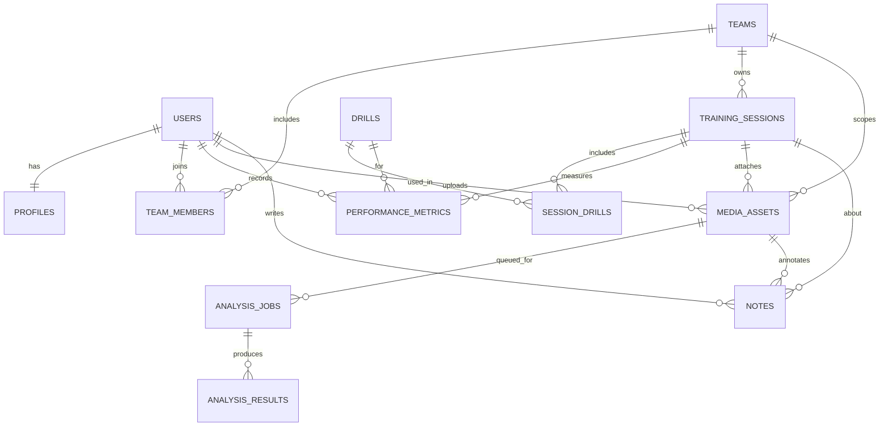

## Data model

Repo: https://github.com/toniilic/flutterflow-sports-performance-backend-starter

This is the **canonical** domain model used by both the Firebase and Supabase tracks.

### Core entities

- **users**: identity from Auth provider (Firebase Auth / Supabase Auth).
- **profiles**: role + display fields for a user (athlete/coach/admin).
- **teams**: an organization/group.
- **team_members**: membership + role within a team.
- **training_sessions**: a session for a team (date/time, title, plan).
- **drills**: exercise/drill library items.
- **session_drills**: drill instances used in a session.
- **performance_metrics**: measurements captured per athlete, per session/drill.
- **media_assets**: videos/images tied to a user/team/session.
- **analysis_jobs**: async job requests for media analysis.
- **analysis_results**: structured outputs (insights, detected events, tags).
- **notes**: coach/athlete notes (optionally anchored to timestamp).

### ERD

### Multi-tenant + visibility rules (conceptual)

- Every team-scoped record carries a **team_id**.
- Every user has a **profile.role** (athlete/coach/admin).
- `team_members.role` controls team-level privileges (coach/admin can view team assets).
- Media is **private by default** and only becomes team-visible if explicitly shared.

### Indexing + pagination strategy

- Prefer **cursor-based pagination**:
  - Firestore: `orderBy(createdAt)` + `startAfter(lastDoc)`.
  - Postgres: `ORDER BY created_at, id` + `WHERE (created_at, id) < (...)`.
- Index common queries:
  - `training_sessions(team_id, starts_at DESC)`
  - `media_assets(team_id, session_id, created_at DESC)`
  - `analysis_jobs(team_id, status, created_at DESC)`
  - `performance_metrics(team_id, athlete_user_id, session_id)`
- Keep AI job processing efficient:
  - index `analysis_jobs(status, created_at)`
  - store idempotency keys (see AI workflow doc)
