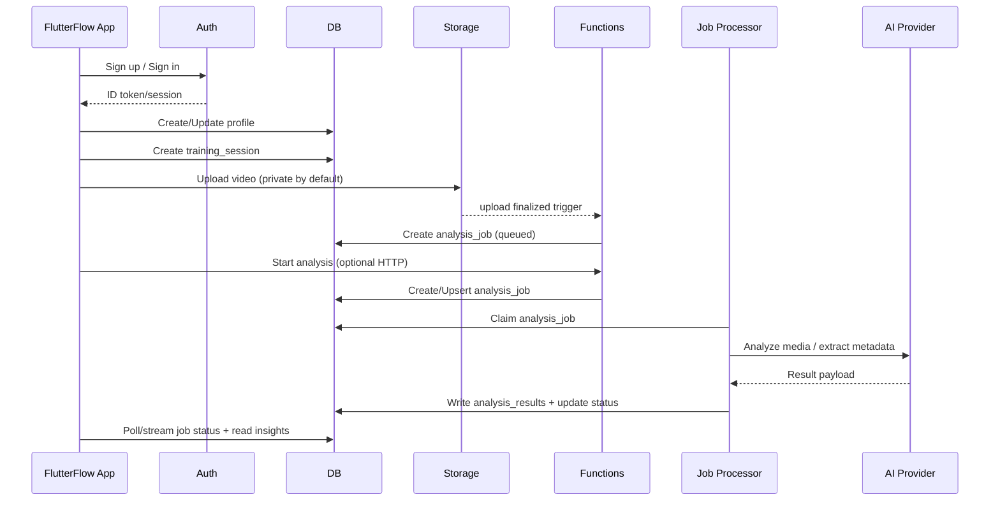

## Architecture overview

Repo: https://github.com/toniilic/flutterflow-sports-performance-backend-starter

This starter is designed around a few stable concepts that work the same across Firebase and Supabase.

### Components

- **FlutterFlow app**: UI, client-side state, and direct reads/writes where appropriate.
- **Auth**:
  - Firebase Auth (Firebase track)
  - Supabase Auth (Supabase track)
- **Database**:
  - Firestore collections (Firebase track)
  - Postgres tables (Supabase track)
- **Storage**:
  - Firebase Storage bucket (Firebase track)
  - Supabase Storage bucket (Supabase track)
- **HTTP Functions**:
  - Cloud Functions (Firebase)
  - Edge Functions (Supabase)
- **Async processing**:
  - Storage upload triggers + “job table” (Firebase)
  - Job table + worker function (Supabase)
- **AI service**:
  - Provider abstraction with an example OpenAI metadata/extraction implementation.
  - Placeholder “video model API” adapter for pose/technique analysis.

### Data flow

### Design goals

- **Secure by default**: private media, least-privilege access, team-scoped visibility.
- **Async-first AI**: analysis is a background job with idempotency and retries.
- **FlutterFlow friendly**: direct DB reads for simple screens; functions for privileged operations.
- **Portable model**: same entity names and lifecycle across both tracks.
